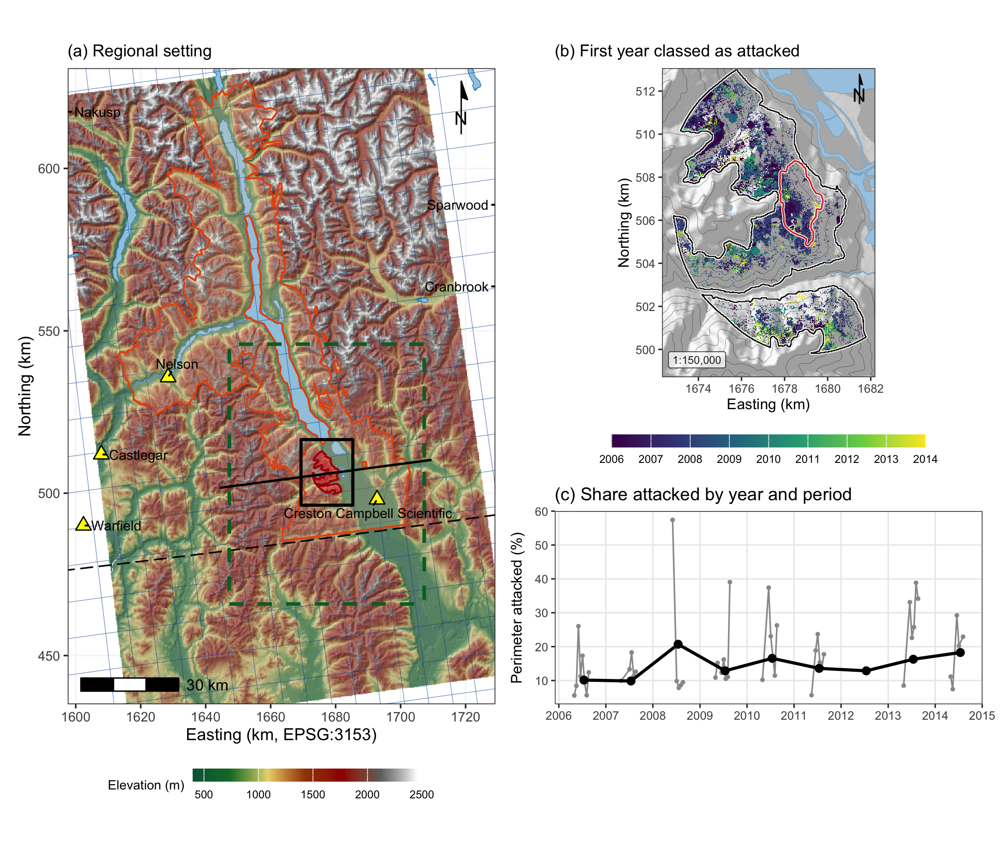
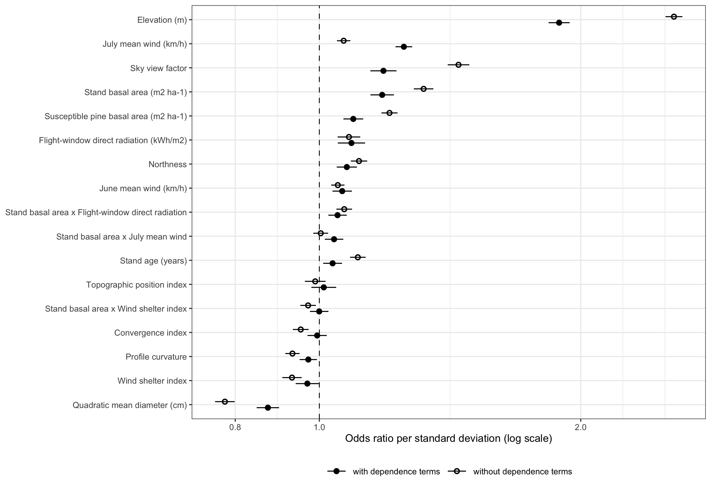
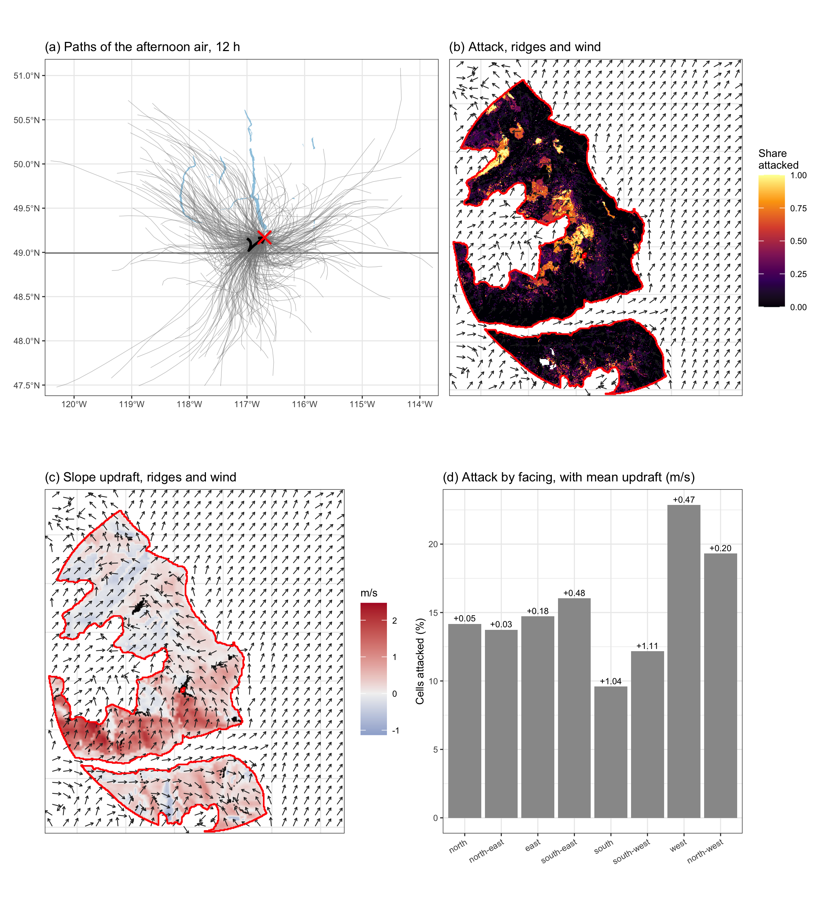

# Testing the wind disruption and disturbance refugia hypothesis for mountain pine beetle outbreaks (*Dendroctonus ponderosae*)

*Terrain, stand density and flight-period wind as controls on attack in the Selkirk Mountains of British Columbia*

## Abstract

1. Disturbance refugia from mountain pine beetle outbreaks have been proposed in thin stands, on shaded ground and where wind disrupts the aggregation pheromone, but few studies have tested these mechanisms together with attack nearby and earlier in the model.
2. This study mapped red-stage attack across 5,573 ha of the Selkirk Mountains, British Columbia, in nine outbreak years and 47 sixteen-day Landsat periods, and modelled it on forest inventory, terrain and wind, entering the previous year’s attack first.
3. Attack was clustered in every year, with positive spatial autocorrelation to a median of 2,640 m, and attack in and around a cell the year before dominated every model.
4. Attack then rose with stand basal area (+0.167 log-odds per standard deviation, p < 0.001), so thin stands had less attack, as the refugia hypothesis predicted, and ground shaded by terrain had less attack while north-facing ground had more; attack peaked in stands of 25 to 30 cm mean diameter and fell among fewer larger pine.
5. Wind during flight lowered attack where canopy was open and raised it where closed (p < 0.001), as plume disruption predicted, and ground facing the afternoon wind had least attack, as deposition predicted, although that effect was small and reversed under a latent spatial field.
6. Refugia on this landscape were thin stands with few host and terrain-shaded ground, wind and shelter added small modifiers to an outbreak spread mostly by contagion, and opening a stand protected it only during flight.

## Figures and tables

Every figure and table of the main text, in the order it appears in the manuscript.

### Figure 1

*The study area and its red-stage attack. (a) Regional setting over the Copernicus 30 m elevation model. The red fill is the study perimeter, 5,573 ha, the black box the window of the 1 m lidar, the orange outline the 2017 lidar project, the green dashed box the regional wind domain, the blue grid the ERA5-Land reanalysis at 0.1 degree, the yellow triangles the seven hourly stations within 150 km, the black line the profile of Figure S3, and the long dash the Canada and United States border. (b) The first year each cell was attacked, with the 2015 Mt Midgeley burn in red. (c) The share of the perimeter attacked each year, black, and in each sixteen-day period, grey, the periods of each summer joined.*

### Table 1

*Descriptive statistics and screening of red-stage attack and the variables of M3 over the 72,000 sampled cell-years before standardisation. Mean, standard deviation (SD) and skewness over the sample, Shapiro-Wilk W on 5,000 cell-years, and the screening on the years with a previous map, β the slope of the variable added alone to the two dependence terms, the deviance it explained and the p-value of the likelihood ratio test. The landform class was screened as a whole by the same likelihood ratio test. Table S3 defines each variable. \* p ≤ 0.05, \*\* p ≤ 0.01, \*\*\* p ≤ 0.001, \*\*\*\* p ≤ 0.0001.*

<table>
<thead>
<tr>
<th width="2000" align="left">Covariate</th>
<th width="2000" align="left">Mean</th>
<th width="2000" align="left">SD</th>
<th width="2000" align="left">Skew</th>
<th width="2000" align="left">W</th>
<th width="2000" align="left">β</th>
<th width="2000" align="left">Deviance</th>
<th width="2000" align="left">LR-test</th>
</tr>
</thead>
<tbody>
<tr><td align="left">Red-stage attack (%), 2006 to 2014</td><td align="left">14.6</td><td align="left">3.65</td><td align="left">+0.30</td><td align="left"></td><td align="left"></td><td align="left"></td><td align="left"></td></tr>
<tr><td align="left">Susceptible pine basal area (m² ha⁻¹)</td><td align="left">8.47</td><td align="left">10.3</td><td align="left">+1.31</td><td align="left">0.804</td><td align="left">+0.3329</td><td align="left">886.97</td><td align="left">0.001****</td></tr>
<tr><td align="left">Stand age (years)</td><td align="left">113</td><td align="left">25.4</td><td align="left">+1.30</td><td align="left">0.893</td><td align="left">+0.0923</td><td align="left">85.93</td><td align="left">0.001****</td></tr>
<tr><td align="left">Quadratic mean diameter (cm)</td><td align="left">26.5</td><td align="left">6.11</td><td align="left">+1.10</td><td align="left">0.934</td><td align="left">-0.0141</td><td align="left">2.19</td><td align="left">0.139</td></tr>
<tr><td align="left">Sky view factor</td><td align="left">88.3</td><td align="left">4.86</td><td align="left">-0.47</td><td align="left">0.984</td><td align="left">+0.4119</td><td align="left">1,362.54</td><td align="left">0.001****</td></tr>
<tr><td align="left">Northness</td><td align="left">0.214</td><td align="left">0.685</td><td align="left">-0.45</td><td align="left">0.886</td><td align="left">+0.0435</td><td align="left">18.26</td><td align="left">0.001****</td></tr>
<tr><td align="left">Elevation (m)</td><td align="left">1,400</td><td align="left">276</td><td align="left">-0.54</td><td align="left">0.906</td><td align="left">+0.7528</td><td align="left">3,987.76</td><td align="left">0.001****</td></tr>
<tr><td align="left">Stand basal area (m² ha⁻¹)</td><td align="left">35.3</td><td align="left">12.4</td><td align="left">-0.78</td><td align="left">0.915</td><td align="left">+0.1961</td><td align="left">371.10</td><td align="left">0.001****</td></tr>
<tr><td align="left">Wind shelter index</td><td align="left">21</td><td align="left">29.8</td><td align="left">+1.70</td><td align="left">0.597</td><td align="left">+0.0650</td><td align="left">43.04</td><td align="left">0.001****</td></tr>
<tr><td align="left">Topographic position index</td><td align="left">3.12</td><td align="left">16.1</td><td align="left">-0.51</td><td align="left">0.977</td><td align="left">+0.1393</td><td align="left">201.48</td><td align="left">0.001****</td></tr>
<tr><td align="left">Convergence index</td><td align="left">0.538</td><td align="left">8.81</td><td align="left">-0.07</td><td align="left">0.974</td><td align="left">+0.0668</td><td align="left">41.60</td><td align="left">0.001****</td></tr>
<tr><td align="left">Profile curvature</td><td align="left">0.0000622</td><td align="left">0.00227</td><td align="left">-0.06</td><td align="left">0.992</td><td align="left">+0.0457</td><td align="left">21.34</td><td align="left">0.001****</td></tr>
<tr><td align="left">Flight-window direct radiation (kWh/m²)</td><td align="left">140</td><td align="left">37.6</td><td align="left">-0.15</td><td align="left">0.993</td><td align="left">+0.2147</td><td align="left">469.53</td><td align="left">0.001****</td></tr>
<tr><td align="left">July mean wind (km/h)</td><td align="left">7.17</td><td align="left">0.576</td><td align="left">+0.25</td><td align="left">0.916</td><td align="left">+0.2349</td><td align="left">501.58</td><td align="left">0.001****</td></tr>
<tr><td align="left">June mean wind (km/h)</td><td align="left">7.18</td><td align="left">0.508</td><td align="left">-0.28</td><td align="left">0.948</td><td align="left">+0.0526</td><td align="left">17.97</td><td align="left">0.001****</td></tr>
<tr><td align="left">Landform class, seven classes against slope</td><td align="left"></td><td align="left"></td><td align="left"></td><td align="left"></td><td align="left"></td><td align="left">139.51</td><td align="left">0.001****</td></tr>
</tbody>
</table>

### Table 2

*Regression estimates of red-stage attack by model, in log-odds per standard deviation of each continuous term, with the landform classes in every model as log-odds against slope, the most common class, ridge including the shoulder cells and a class of fewer than 30 cells not estimated. M0 held host size, shading and landform, M1 added stand basal area, M2 terrain exposure, shape and flight-window radiation, and M3 the interactions, over the nine years; M3 was refitted with the dependence terms over the eight years with a previous map, and with a latent spatial field. Performance is the AUC and RMSE of the full fit, the RMSE ratio of the test folds over the training folds under ten-fold cross-validation on 1 km blocks, and Theil’s U bias. \* p ≤ 0.05, \*\* p ≤ 0.01, \*\*\* p ≤ 0.001.*

<table>
<thead>
<tr>
<th width="2000" align="left">Term</th>
<th width="2000" align="center">M0</th>
<th width="2000" align="center">M1</th>
<th width="2000" align="center">M2</th>
<th width="2000" align="center">M3</th>
<th width="2000" align="center">M3 + dependence</th>
<th width="2000" align="center">M3 + field</th>
</tr>
</thead>
<tbody>
<tr><td align="left">Susceptible pine basal area</td><td align="center">+0.272***</td><td align="center">+0.195***</td><td align="center">+0.191***</td><td align="center">+0.186***</td><td align="center">+0.090***</td><td align="center">+0.032</td></tr>
<tr><td align="left">Stand age</td><td align="center">+0.118***</td><td align="center">+0.101***</td><td align="center">+0.101***</td><td align="center">+0.102***</td><td align="center">+0.035**</td><td align="center">+0.029</td></tr>
<tr><td align="left">Quadratic mean diameter</td><td align="center">-0.097***</td><td align="center">-0.249***</td><td align="center">-0.250***</td><td align="center">-0.250***</td><td align="center">-0.136***</td><td align="center">-0.069***</td></tr>
<tr><td align="left">Sky view</td><td align="center">+0.420***</td><td align="center">+0.381***</td><td align="center">+0.387***</td><td align="center">+0.369***</td><td align="center">+0.170***</td><td align="center">+0.037</td></tr>
<tr><td align="left">Northness</td><td align="center">+0.128***</td><td align="center">+0.077***</td><td align="center">+0.100***</td><td align="center">+0.105***</td><td align="center">+0.073***</td><td align="center">+0.133***</td></tr>
<tr><td align="left">Elevation</td><td align="center">+0.934***</td><td align="center">+0.945***</td><td align="center">+0.941***</td><td align="center">+0.940***</td><td align="center">+0.636***</td><td align="center">+1.199***</td></tr>
<tr><td align="left">Stand basal area</td><td align="center"></td><td align="center">+0.279***</td><td align="center">+0.273***</td><td align="center">+0.276***</td><td align="center">+0.167***</td><td align="center">+0.200***</td></tr>
<tr><td align="left">Wind shelter index</td><td align="center"></td><td align="center"></td><td align="center">-0.069***</td><td align="center">-0.073***</td><td align="center">-0.032*</td><td align="center">+0.096***</td></tr>
<tr><td align="left">Topographic position</td><td align="center"></td><td align="center"></td><td align="center">-0.022</td><td align="center">-0.011</td><td align="center">+0.012</td><td align="center">+0.023</td></tr>
<tr><td align="left">Convergence</td><td align="center"></td><td align="center"></td><td align="center">-0.049***</td><td align="center">-0.049***</td><td align="center">-0.006</td><td align="center">+0.011</td></tr>
<tr><td align="left">Profile curvature</td><td align="center"></td><td align="center"></td><td align="center">-0.074***</td><td align="center">-0.071***</td><td align="center">-0.029*</td><td align="center">-0.002</td></tr>
<tr><td align="left">Flight-window radiation</td><td align="center"></td><td align="center"></td><td align="center">+0.062***</td><td align="center">+0.078***</td><td align="center">+0.085***</td><td align="center">+0.215***</td></tr>
<tr><td align="left">July wind</td><td align="center"></td><td align="center"></td><td align="center"></td><td align="center">+0.064***</td><td align="center">+0.224***</td><td align="center">+0.209***</td></tr>
<tr><td align="left">June wind</td><td align="center"></td><td align="center"></td><td align="center"></td><td align="center">+0.049***</td><td align="center">+0.061***</td><td align="center">+0.064***</td></tr>
<tr><td align="left">Attack in the cell, previous year</td><td align="center"></td><td align="center"></td><td align="center"></td><td align="center"></td><td align="center">+2.208***</td><td align="center">+2.282***</td></tr>
<tr><td align="left">Attack within 150 m, previous year</td><td align="center"></td><td align="center"></td><td align="center"></td><td align="center"></td><td align="center">+2.216***</td><td align="center">+0.905***</td></tr>
<tr><td align="left">Basal area × shelter</td><td align="center"></td><td align="center"></td><td align="center"></td><td align="center">-0.030**</td><td align="center">-0.000</td><td align="center">+0.009</td></tr>
<tr><td align="left">Basal area × July wind</td><td align="center"></td><td align="center"></td><td align="center"></td><td align="center">+0.004</td><td align="center">+0.039**</td><td align="center">+0.034*</td></tr>
<tr><td align="left">Basal area × radiation</td><td align="center"></td><td align="center"></td><td align="center"></td><td align="center">+0.066***</td><td align="center">+0.048***</td><td align="center">-0.018</td></tr>
<tr><td align="left">Landform class, against slope</td><td align="center"></td><td align="center"></td><td align="center"></td><td align="center"></td><td align="center"></td><td align="center"></td></tr>
<tr><td align="left">Slope, 38,898 cells, 14 per cent attacked</td><td align="center">reference</td><td align="center">reference</td><td align="center">reference</td><td align="center">reference</td><td align="center">reference</td><td align="center">reference</td></tr>
<tr><td align="left">Spur, 11,796 cells, 18 per cent attacked</td><td align="center">-0.107***</td><td align="center">-0.059**</td><td align="center">-0.012</td><td align="center">-0.011</td><td align="center">+0.080*</td><td align="center">+0.031</td></tr>
<tr><td align="left">Hollow, 8,751 cells, 12 per cent attacked</td><td align="center">+0.071*</td><td align="center">+0.036</td><td align="center">-0.024</td><td align="center">-0.028</td><td align="center">+0.057</td><td align="center">+0.049</td></tr>
<tr><td align="left">Valley, 1,609 cells, 11 per cent attacked</td><td align="center">+0.013</td><td align="center">-0.069</td><td align="center">-0.200**</td><td align="center">-0.210**</td><td align="center">-0.002</td><td align="center">+0.054</td></tr>
<tr><td align="left">Ridge, 665 cells, 24 per cent attacked</td><td align="center">-0.626***</td><td align="center">-0.528***</td><td align="center">-0.453***</td><td align="center">-0.447***</td><td align="center">+0.038</td><td align="center">+0.068</td></tr>
<tr><td align="left">Peak, 32 cells, 42 per cent attacked</td><td align="center">-0.475</td><td align="center">-0.368</td><td align="center">-0.284</td><td align="center">-0.268</td><td align="center">+0.063</td><td align="center">+0.456</td></tr>
<tr><td align="left">Footslope, 1 cell, 89 per cent attacked</td><td align="center">not estimated</td><td align="center">not estimated</td><td align="center">not estimated</td><td align="center">not estimated</td><td align="center">not estimated</td><td align="center">not estimated</td></tr>
<tr><td align="left">AUC</td><td align="center">0.804</td><td align="center">0.807</td><td align="center">0.808</td><td align="center">0.809</td><td align="center">0.890</td><td align="center"></td></tr>
<tr><td align="left">RMSE</td><td align="center">0.423</td><td align="center">0.422</td><td align="center">0.421</td><td align="center">0.421</td><td align="center">0.365</td><td align="center"></td></tr>
<tr><td align="left">RMSE ratio</td><td align="center">1.003</td><td align="center">1.000</td><td align="center">1.005</td><td align="center">1.008</td><td align="center">0.998</td><td align="center"></td></tr>
<tr><td align="left">Theil’s U bias</td><td align="center">0.0000</td><td align="center">0.0001</td><td align="center">0.0001</td><td align="center">0.0001</td><td align="center">0.0000</td><td align="center"></td></tr>
</tbody>
</table>

### Figure 2

*Odds ratios of the environmental terms of M3 per standard deviation, with 95 per cent confidence intervals, without the dependence terms over the nine years, open circles, and with them over the eight years with a previous map, filled circles. Terms are ordered by their odds ratio with the dependence terms, and the dashed line marks no effect.*

### Figure 3

*The afternoon air over the site and the attack it met, 1 July to 15 August. (a) HYSPLIT paths of the air over the 12 h before 14:00 on each flight day of 2005 to 2013, with the mean path in black. (b) The share of the annual maps of 2006 to 2014 on which each cell was attacked, with ridges in black and the modelled flight-hour wind as arrows. (c) The slope updraft of that wind, red where it rose and blue where it sank. (d) The share of cells attacked by the direction the ground faced, with the mean updraft above each bar. The red outline is the study perimeter.*
